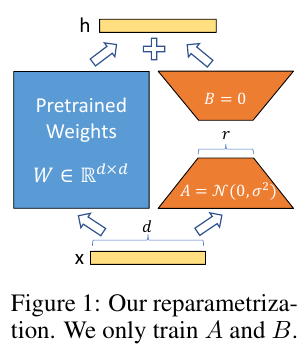
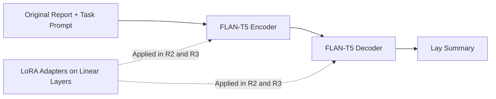
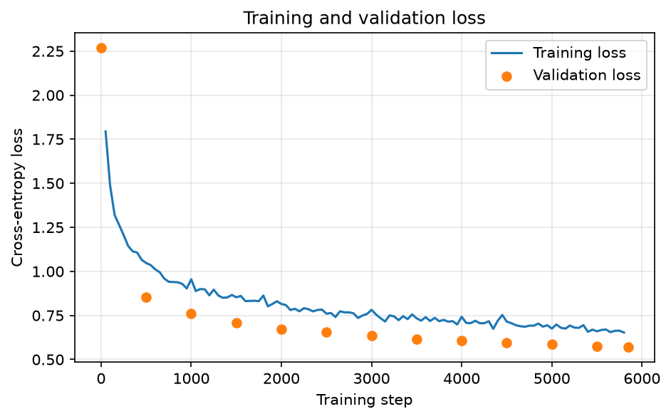
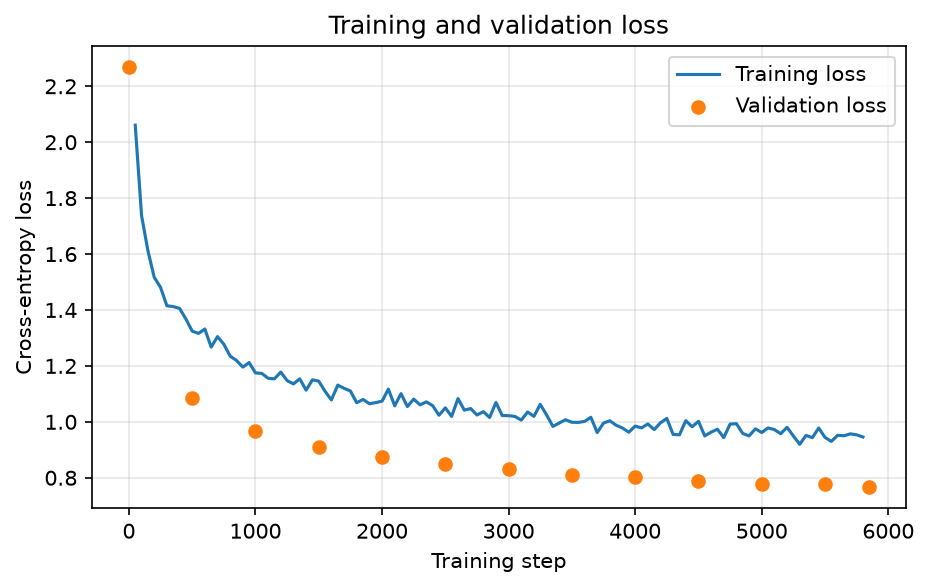
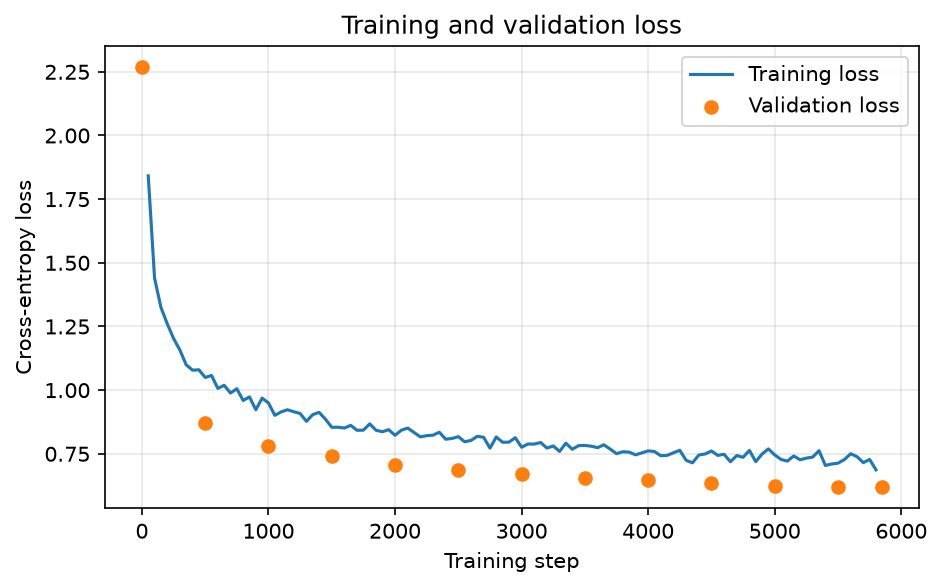
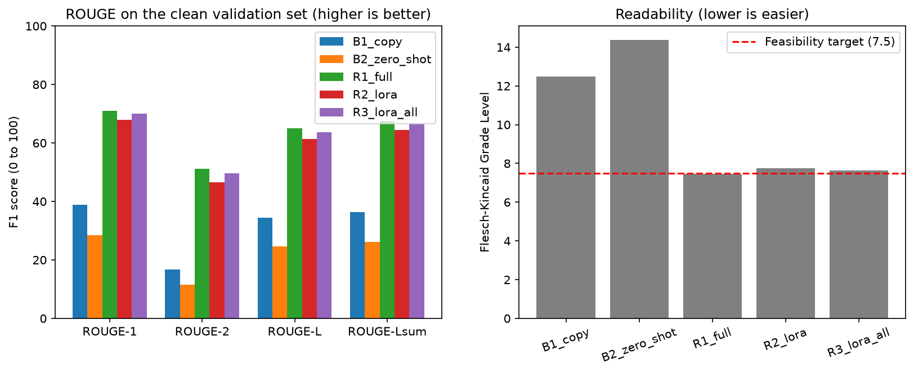

# Radiology Report Lay Summarisation Using FLAN-T5 and LoRA

**Author:** Renhe Wang (s49851975)  

## 1. Overview

Radiology reports are written for doctors, so patients often find them hard to understand when they read their results online. This project fine-tunes `FLAN-T5-base` to rewrite English radiology reports into plain summaries for patients. For example:

> **Original report:** "Marked cardiomegaly. Nasogastric tube in the abdomen."
>
> **Fine-tuned model:** "The heart is significantly enlarged. There is a tube going through the nose into the stomach."

I compare full fine-tuning with two Low-Rank Adaptation (LoRA) settings, and with two baselines: copying the original report, and the untuned zero-shot `FLAN-T5-base`. This is a coursework prototype, not a clinical system.

The project looks at two questions:

1. Can LoRA get close to full fine-tuning while training far fewer parameters?
2. When ROUGE goes up after fine-tuning, does the summary also keep the medical facts correct?

The second question matters because ROUGE only counts word overlap with a reference summary. A summary can share most of its words with the reference but still miss a finding, add a disease, or turn "possible" into "definite".

## 2. Background and How It Works

Rewriting reports in plain English helps patients, but simpler wording can lose medical meaning. Yang, Cherian, and Vucetic (2024) found that fluent, easy radiology sentences could still lose uncertainty or add facts, so human checking is still needed.

**FLAN-T5.** T5 treats every task as text-to-text with an encoder–decoder transformer (Raffel et al., 2020). The encoder reads the report and the decoder writes the summary one token at a time. FLAN-T5 is T5 further trained on many instruction tasks (Chung et al., 2022), so it can follow a short prompt placed before each report. I chose `FLAN-T5-base`, which has about 248M parameters, because a T5 system ranked first overall on the BioLaySumm 2025 radiology task (Zhang et al., 2025), and the base size can be trained on one GPU.

**LoRA.** Full fine-tuning updates every weight. LoRA freezes the pretrained weights and only trains two small matrices added to selected linear layers (Hu et al., 2022):

$$W = W_0 + \frac{\alpha}{r} B A$$

Here $W_0$ is the frozen weight, $A$ and $B$ are trainable matrices with rank $r$, and $\frac{\alpha}{r}$ scales the update. $B$ starts at zero, so at the start the model gives exactly the same output as the original. Before inference, `predict.py` merges $\frac{\alpha}{r} B A$ into $W_0$, so generation is not slower. Biderman et al. (2024) found that LoRA can learn less than full fine-tuning on a new domain, especially with a small rank or only the query and value layers, so I test how close it gets on this task.



*Figure 1: LoRA structure (Hu et al., 2022). The pretrained weight is frozen and only $A$ and $B$ are trained.*



*Figure 2: Workflow. R2 and R3 add LoRA adapters to the linear layers of the encoder and decoder.*

## 3. Original Feasibility Review

Below is the one-page feasibility review I presented at the project midpoint. It is kept unchanged.

> **Feasibility Review: Radiology Report Lay Summarisation (COMP3710 Project 2.6)**  
> Renhe Wang (s49851975) · 21 October 2026
>
> **1. Topic and Performance Evaluation**
> - **Topic & Scope:** Fine-tune a language model to rewrite English chest X-ray reports into plain summaries for patients reading reports online (non-clinical prototype).
> - **How Performance is Measured:** In my test example, changing "no pleural effusion" to "there is fluid" still gave a high ROUGE-1 of 97.0, while an accurate paraphrase scored 33.3. Therefore, I evaluate the model using five criteria on the official validation split (10,000 rows):
>
> | Criterion | Pass Condition |
> |---|---|
> | 1. Safety | ≤ 2 of 50 random summaries have hallucinations, omissions, or certainty changes (manual check), with fewer errors than the zero-shot model. |
> | 2. Relevance | ROUGE-1, -2, -L, and -Lsum beat both baselines (copying the report and the untuned zero-shot model). |
> | 3. Readability | Mean Flesch-Kincaid Grade Level (FKGL) ≤ 7.5 (matching reference summaries). |
> | 4. LoRA | Reaches ≥ 95% of full fine-tuning's ROUGE-L and passes Criterion 1. |
> | 5. Cost | Peak VRAM ≤ 16 GB (one T4 GPU) and runtime ≤ 4 hours per epoch. |
>
> **2. Model Choice**
> - **Model:** FLAN-T5-base (248M parameters). I compare full fine-tuning (updating all weights) against LoRA (freezing weights and training rank-8 matrices on attention query and value layers).
> - **Why:** Fine-tuned T5 models perform strongly on this radiology task (Zhang et al., 2025), and FLAN-T5 adds instruction tuning to T5 (Chung et al., 2022). LoRA saves memory (Hu et al., 2022) but can underperform on new domains (Biderman et al., 2024), so comparing both tests this trade-off.
> - **Course Concepts:** Attention, encoder–decoder transformers, transfer learning, low-rank adaptation, and leakage-free data splitting.
>
> **3. Preliminary Feasibility Evidence**
> - **Data Audit:** 45% (4,506 / 10,000) of validation reports leaked into the training set. Removing duplicates and leaked rows leaves 86,785 training and 4,570 development pairs. Reports have a median length of 58 tokens; a 640-token limit truncates < 0.2% of data. Reference summaries average FKGL 7.5 (only 31% reach grade 6), justifying the 7.5 target.
> - **Memory Estimate:** Full fine-tuning with AdamW takes ≈ 4 GB for states (248M × 16 bytes) plus activations, fitting a 16 GB T4. LoRA trains only 0.88M parameters (0.36%).
>
> **4. Possible Problems, Causes, and Improvements**
>
> | Possible Problem | Possible Cause | How to Improve It |
> |---|---|---|
> | ROUGE goes up, but medical facts are wrong | Cross-entropy loss treats words like "no" equally; GPT-4o reference summaries may contain noise (Xiao et al., 2025). | Manually check 50 summaries; add an automated rule check to verify findings and negations ("no", "possible"). |
> | LoRA performs much worse than full fine-tuning | Rank-8 on only query/value layers is too small to learn clinical domain terms (Hu et al., 2022). | Increase LoRA rank, apply LoRA to all linear layers, and raise the learning rate (Biderman et al., 2024). |
> | Training is too slow or runs out of memory | A few long reports force excessive padding across the whole batch. | Group reports of similar length into the same batch and reduce batch size. |
>
> - **Budget, Next Step & Fallback:** Max 15 GPU hours on one Colab T4 plus 3 hours of manual checking. Next, I will run both baselines on the validation split and train each method for 1 epoch. If 1 epoch exceeds 4 hours, I will train full fine-tuning on a data subset; if Safety fails, I will add the automated negation/finding check before deployment.

### Changes During Implementation

- **Evaluation set:** 45% of the official validation split had leaked into training, so all models were evaluated on the cleaned set of 5,449 pairs. The final counts from `dataset.py` (93,505 training pairs, 5,449 validation pairs, median report length 45 tokens) replace the early draft numbers in the review (86,785, 4,570 and 58).
- **Extra LoRA run:** R2 reached 94.4% of R1's ROUGE-L, just under the 95% target, so I ran the fix planned in the review as R3: rank 16 on all linear layers.
- **Hardware:** The final runs used an NVIDIA RTX PRO 6000 GPU on Google Colab instead of a 16 GB T4.
- **Readability:** I kept the FKGL ≤ 7.5 target from the review and also compare against the assignment's 6th-grade target.

## 4. Dataset and Preprocessing

I use the BioLaySumm 2025 LaymanRRG open-source track dataset (`BioLaySumm/BioLaySumm2025-LaymanRRG-opensource-track` on Hugging Face; BioLaySumm, 2025; Xiao et al., 2025; Zhao et al., 2026). Each example pairs an English radiology report with a lay summary. The reference summaries were generated with GPT-4o (Zhao et al., 2026). The review called the data chest X-ray reports, but it also contains other scans, such as CT of the lungs and leg veins (Sample 1143) and abdominal exams (Sample 4139).

Table 1 shows the splits before and after cleaning, taken from `outputs/data_audit.txt`.

| Split | Raw Rows | Leaked into Train | Clean Rows Used | Median Report Tokens | Median Summary Tokens | Inputs > 640 Tokens | Summaries > 640 Tokens | Mean Reference FKGL |
|---|---:|---:|---:|---:|---:|---:|---:|---:|
| Train | 150,454 | — | 93,505 | 45 | 57 | 0.132% | 0.179% | 7.52 |
| Validation | 10,000 | 4,506 | 5,449 | 47 | 60 | 0.055% | 0.202% | 7.54 |
| Test | 10,537 | — | 10,537 | — | — | — | — | — |

The training set is used for training. The cleaned validation set is used for validation loss and all final metrics. The official test set has no reference summaries, so it cannot be scored with ROUGE, and `predict.py` only uses it to show example outputs.

**Leakage removal in `dataset.py`:**

1. Normalise each report by lowercasing it and removing extra spaces before comparing.
2. Remove repeated reports inside the training set, which leaves 93,505 of the 150,454 pairs.
3. Remove the 4,506 validation reports that also appear in training, then the 45 repeated reports inside validation, leaving 5,449 pairs.

**Text processing:**

- Add the prompt `"Simplify this radiology report for a patient: "` before every report.
- Tokenize with a 640-token limit. Less than 0.21% of inputs or targets are truncated.
- Pad each batch only to its longest sequence.
- Set padded label positions to `-100` so the loss ignores them.

## 5. Experimental Setup

| ID | Method | Trainable Layers | Rank / Alpha | Learning Rate |
|---|---|---|---|---|
| B1 | Copy the original report | None | — | — |
| B2 | Zero-shot `FLAN-T5-base` | None | — | — |
| R1 | Full fine-tuning | All parameters | — | 1e-4 |
| R2 | LoRA, rank 8, query and value | 72 attention `q`, `v` layers | $r = 8, \alpha = 16$ | 1e-3 |
| R3 | LoRA, rank 16, all linear layers | All 216 linear layers: `q, k, v, o, wi_0, wi_1, wo` | $r = 16, \alpha = 32$ | 1e-3 |

*Table 2: The five configurations.*

R1, R2 and R3 were each trained for 1 epoch of 5,845 steps with seed 42, batch size 16, AdamW, bfloat16 and gradient clipping at 1.0. Following Biderman et al. (2024), LoRA uses a 10 times higher learning rate and $\alpha = 2r$. All models generate with the same prompt, 4-beam search, `max_new_tokens = 640` and batch size 32, and all five are scored on the same 5,449 validation pairs. R3 changes both the rank and the layers compared with R2, so it shows the effect of both changes together.

**Metrics:** I report ROUGE-1, -2, -L and -Lsum F1 (Lin, 2004), computed with `rouge-score` using stemming and `nltk` sentence splitting for Lsum. Readability is the Flesch–Kincaid Grade Level, FKGL (Kincaid et al., 1975), computed with `textstat`, where lower means easier to read. Both only measure surface words and sentence length, so I also do a manual safety review in Section 7.

| R1 Full fine-tuning | R2 LoRA rank 8 | R3 LoRA rank 16 |
|---|---|---|
|  |  |  |

*Figure 3: Training and validation loss over 1 epoch.*

All three runs start at a validation loss of 2.2680 and go down smoothly, ending at 0.5697 (R1), 0.7662 (R2) and 0.6193 (R3). R3 follows R1 much more closely than R2 does.

## 6. Results

### 6.1 ROUGE and Readability

| Model | ROUGE-1 | ROUGE-2 | ROUGE-L | ROUGE-Lsum | FKGL |
|---|---:|---:|---:|---:|---:|
| B1 Copy original report | 38.95 | 16.71 | 34.45 | 36.38 | 12.47 |
| B2 Zero-shot | 28.41 | 11.51 | 24.67 | 26.09 | 14.37 |
| R1 Full fine-tuning | **71.04** | **51.11** | **64.95** | **67.61** | **7.48** |
| R2 LoRA rank 8 | 67.97 | 46.64 | 61.32 | 64.39 | 7.76 |
| R3 LoRA rank 16 | 69.97 | 49.56 | 63.59 | 66.47 | 7.63 |

*Table 3: Results on the 5,449 validation pairs, from `outputs/*/metrics.json`. Best values in bold.*

- Fine-tuning beats both baselines by more than 28 points on ROUGE-1 and 26 points on ROUGE-L. B2 is even worse than copying the report, because it often repeats the prompt or drops most of the report.
- R3 is close to full fine-tuning. Its ROUGE-L is 97.9% of R1's, while R2 reaches 94.4%.
- Readability improves to about grade 7–8. FKGL drops from 12.47 for B1 and 14.37 for B2 to 7.48–7.76. Only R1 meets the 7.5 target, and no model reaches the 6th-grade target. All are close to the reference summaries' average of 7.54.



*Figure 4: ROUGE F1 on the left and mean FKGL on the right. The dashed line is the FKGL target of 7.5.*

### 6.2 Computational Cost

| Model | Total / Trainable Parameters | Trainable Share | Peak Allocated VRAM | Training Time per Epoch | Generation Speed |
|---|---:|---:|---:|---:|---:|
| R1 Full fine-tuning | 247.58M / 247.58M | 100.00% | 29.77 GiB | 8.97 min | ~2,657 tokens/s |
| R2 LoRA rank 8 | 248.46M / 0.88M | 0.36% | 23.39 GiB | 6.76 min | ~2,590 tokens/s |
| R3 LoRA rank 16 | 254.36M / 6.78M | 2.67% | 25.78 GiB | 9.07 min | ~2,560 tokens/s |

*Table 4: Cost on an NVIDIA RTX PRO 6000 Blackwell Server Edition GPU, from `outputs/*/run_summary.json` and `metrics.json`. B2 generated at about 2,628 tokens/s.*

- With batch size 16, all runs used more VRAM than the 16 GB target. Compared with R1, LoRA saved 6.38 GiB or 21.4% for R2, and 3.99 GiB or 13.4% for R3. Most memory is used by activations of long reports, so a smaller batch size would use less.
- Training times do not include the validation checks every 500 steps. R3 is a little slower than R1 because it adds LoRA paths to all 216 linear layers.
- LoRA is merged before generation, so all models have about the same batch throughput.

## 7. Clinical Safety Review

### 7.1 Method

I took a fixed random sample of 50 validation examples with `random.Random(42).sample(range(5449), 50)` and compared the 200 summaries from B2, R1, R2 and R3 with the original reports. Each error is labelled with one letter. H is a hallucination: the summary adds a fact, reverses a finding, or gives a wrong medical definition. O is an omission: it leaves out a meaningful finding, device, comparison or follow-up advice. C is a certainty or cause change: it turns "possible" into "definite", or gives a cause the report does not state. R is a readability issue: unexplained jargon or repeated sentences.

A summary with any H, O or C error counts as one error. R issues and borderline cases I could not confirm are not counted.

| Model | Summaries with Errors (out of 50) | Error Rate in Sample |
|---|---:|---:|
| B2 Zero-shot | 30 / 50 | 60.0% |
| R1 Full fine-tuning | 4 / 50 | 8.0% |
| R2 LoRA rank 8 | 11 / 50 | 22.0% |
| R3 LoRA rank 16 | 4 / 50 | 8.0% |

*Table 5: Summaries with at least one H, O or C error.*

Fine-tuning reduces errors a lot compared with zero-shot, but every model is still above the 2/50 limit from the feasibility review.

### 7.2 Failure Case Analysis

These five cases come from the 50-sample review. I use validation cases because the test split has no reference summaries, so single-example ROUGE-L cannot be computed there.

#### Case 1 – Sample 53: "Infiltrates" turned into an infection

- **Report:** "Decreased volume of the left lung. Persistent pulmonary infiltrates in the left lung."
- **Reference:** "The left lung has less air in it. There are ongoing signs of lung inflammation in the left lung."
- **B2:** "This radiology report summarizes the findings of a pulmonary infiltrate in the left lung."
- **R1:** "The left lung has less air in it. There are ongoing signs of lung infections in the left lung."
- **R3:** "The left lung is smaller than usual. There are ongoing lung infections in the left lung."
- **ROUGE-L:** B2 36.36 | R1 94.74 | R2 77.78 | R3 62.86

An infiltrate is a nonspecific shadow that can have many causes, and the report never says infection. R1, R2 and R3 all call it an infection (C). B2 drops the lower lung volume (O) and leaves the jargon unexplained (R). R1 scores 94.74 because it only changes one word, "inflammation" to "infections", but that word tells the patient they have an infection the radiologist never diagnosed. This is the main problem of the project.

#### Case 2 – Sample 839: A benign hamartoma explained as cancer

- **Report:** "… A persistent pulmonary nodule measuring one centimeter is noted, unchanged compared to the previous study … The patient underwent a chest CT in 2004, with findings suggestive of a hamartoma."
- **R1:** "…it looks like it might be a type of cancer called a hamartoma.…"
- **R3:** "…it looks like it might be a type of lung infection called hamartoma.…"
- **ROUGE-L:** B2 44.44 | R1 76.92 | R2 67.86 | R3 71.19

A hamartoma is a benign growth, not a cancer (National Cancer Institute, n.d.). Both models keep the uncertainty ("might be") but give a wrong definition (H). R1 has the highest ROUGE-L here while telling the patient they might have cancer.

#### Case 3 – Sample 3100: "Vascular redistribution" turned into blood clots

- **Report:** "… The cardiac silhouette is enlarged. Signs of vascular redistribution are present. A pseudonodular image is noted in the left lung base; the patient is advised to complete the study with a CT scan."
- **R2:** "…There are signs of blood clots in the lungs.…"
- **R3:** "…There are signs of blood flow changes in the blood vessels.…"
- **ROUGE-L:** B2 23.40 | R1 80.58 | R2 66.67 | R3 73.97

R2 invents blood clots in the lungs, a serious acute condition that is not in the report (H), while R3 keeps the meaning. B2 says "the right lung base is enlarged" (H) and drops the enlarged heart and the CT advice (O).

#### Case 4 – Sample 2278: Lung nodules hidden behind "no changes"

- **Report:** "… marked improvement in the left pleural effusion … A drainage tube is noted … Bilateral pulmonary nodules are present with no significant changes compared to the previous control."
- **R2:** "…Both lungs show no significant changes compared to the last check.…"
- **R3:** "…Both lungs have small lumps, and they haven't changed much since the last check.…"
- **ROUGE-L:** B2 21.57 | R1 73.81 | R2 62.03 | R3 63.58

R2 never says there are nodules in both lungs (O), and B2 drops both the nodules and the drainage tube (O). R2 and R3 have almost the same ROUGE-L, but only R3 tells the patient about the nodules.

#### Case 5 – Sample 4139: Repetition on a long multi-organ report

- **Report:** "Patient: 72-year-old male with anemic syndrome … Splenomegaly of 16 cm is observed. … Minimal laminar perihepatic ascites is noted. … The pancreas appears involuted. … [kidney lesion, 28 mm adnexal cyst, lungs, spine] … loss of height of the superior endplate of T12."
- **R3:** "is diagnosed with microcytic anemia... There's a small amount of fluid around the liver, which might be due to a condition called calcific aorta... The pancreas looks a bit enlarged", then repeats these sentences until the length limit.
- **ROUGE-L:** B2 15.91 | R1 45.50 | R2 37.44 | R3 29.21

R3 turns an involuted, meaning shrunken, pancreas into an enlarged one (H), states a diagnosis and a cause the report does not give (C), and because of the loop drops everything from the kidneys to the spine (O). R1 says the spleen is enlarged "by" 16 cm, adds "no bile ducts" (H) and copies the second half in jargon. B2 turns positive findings into negative ones (H). The input is only 346 tokens, well under the 640 limit, so this is not truncation. The models break down when decoding a long list of findings.

**Test split examples:** `predict.py` also summarises the first three official test reports. Test report 2 is the example in Section 1. On test report 3, all fine-tuned models keep "probably", "likely" and the CT advice. On test report 1, a long report repeated three times in the dataset, all fine-tuned models get stuck in a repetition loop like Case 5.

## 8. Evaluation Against the Feasibility Criteria

| Criterion | Pass Condition | Evidence | Result |
|---|---|---|---|
| 1. Safety | ≤ 2 of 50 summaries have H, O or C errors, and fewer errors than zero-shot (B2). | R1 (4/50), R2 (11/50) and R3 (4/50) all beat B2 (30/50), but all are above 2/50. | Not passed |
| 2. Relevance | ROUGE-1, -2, -L and -Lsum beat both baselines (B1 and B2). | R1–R3 score 67.97–71.04 ROUGE-1 and 61.32–64.95 ROUGE-L, far above B1 (38.95 / 34.45) and B2 (28.41 / 24.67). | Passed |
| 3. Readability | Mean FKGL ≤ 7.5. | R1 gets 7.48. R3 (7.63) and R2 (7.76) are slightly above 7.5. | R1 only |
| 4. LoRA | ≥ 95% of full fine-tuning's ROUGE-L and passes Criterion 1. | R2 reaches 94.4%. R3 reaches 97.9% but fails Criterion 1 (4/50). | Not passed |
| 5. Cost | Peak VRAM ≤ 16 GB and ≤ 4 hours per epoch. | Training takes 6.76–9.07 min per epoch, but peak VRAM is 23.39–29.77 GiB. | Not passed |

*Table 6: Results against the five criteria from the feasibility review (Section 3).*

## 9. Discussion and Recommendation

**Can LoRA match full fine-tuning?** Yes, with a large enough rank and enough layers. R2 (0.36% trainable) is clearly behind R1 in both ROUGE-L and errors (11/50 vs 4/50). R3 (2.67% trainable) reaches 97.9% of R1's ROUGE-L with the same 4/50 errors. Since R3 changed the rank and the layers together, I cannot say which change helped more.

**Does higher ROUGE mean correct facts?** Fine-tuning does cut errors from 30/50 to 4/50, but ROUGE cannot prove safety. Cases 1 and 2 show summaries with high ROUGE-L that invent an infection or call a benign growth cancer.

**Limitations:**

- The same validation set was used for validation loss, for deciding to run R3 and for final metrics, because the test set has no references.
- Leakage removal only matches exact text. Without patient IDs, same-patient or near-duplicate reports may still cross splits.
- The GPT-4o references contain some noise. For example, Sample 355's reference has a raw JSON-like fragment. High ROUGE therefore partly means copying GPT-4o's style.
- Each model was trained once with one seed.
- Only 50 samples were reviewed, by me, and I am not a radiologist.

**Recommendation to the project manager:**

- Keep developing, with R3 as the main option. It is almost as good as R1 while training 97.3% fewer parameters, and its adapters are small to store.
- Do not show the current models to patients. None passed the safety criterion, and errors like wrong cancer definitions and invented blood clots are real risks.
- Add guardrails before any clinical pilot. Automatically check the summary against the report for medical entities, left and right sides, negation words such as "no" and "without", uncertainty words such as "possible", and follow-up advice, and have a clinician review every summary before a patient sees it.

## 10. Usage and Reproducibility

The runs used Google Colab with Python 3.13.16, PyTorch 2.11.0 with CUDA 13.0 and an NVIDIA RTX PRO 6000 GPU. Package versions are pinned in [`requirements.txt`](requirements.txt):

```text
torch==2.11.0
transformers==5.20.2
datasets==4.8.5
textstat==0.7.13
matplotlib==3.10.0
rouge-score==0.1.2
nltk==3.9.1
```

```bash
pip install -r requirements.txt
```

`dataset.py` downloads the dataset from Hugging Face automatically and applies the cleaning in memory.

**Files:**

- [`dataset.py`](dataset.py): data loading, leakage removal, prompting, tokenization, padding with `-100` masking, and the data audit.
- [`modules.py`](modules.py): `LoRALinear` and `apply_lora` in pure PyTorch without NumPy or `peft`, model building, parameter counting and two unit checks.
- [`train.py`](train.py): training loop, loss logging and plotting, VRAM and time recording, and saving weights.
- [`predict.py`](predict.py): loads weights, merges LoRA, prints test-split examples, computes ROUGE, FKGL and tokens/s, and plots the comparison chart.

**Commands:** run these inside `recognition/FLAN_T5_LoRA_s49851975/`. Outputs go to `outputs/reproduction/`.

```bash
# 1. Check data cleaning and LoRA unit checks
python dataset.py
python modules.py

# 2. Train R1, R2 and R3 (seed 42)
python train.py --mode full --learning-rate 1e-4 --output-dir outputs/reproduction/R1_full
python train.py --mode lora --learning-rate 1e-3 --lora-rank 8 --lora-alpha 16 \
    --targets query_value --output-dir outputs/reproduction/R2_lora
python train.py --mode lora --learning-rate 1e-3 --lora-rank 16 --lora-alpha 32 \
    --targets all_linear --output-dir outputs/reproduction/R3_lora_all

# 3. Evaluate all five configurations and plot the comparison chart
python predict.py --model copy --run-dir outputs/reproduction/B1_copy
python predict.py --model zero_shot --run-dir outputs/reproduction/B2_zero_shot
python predict.py --model full --run-dir outputs/reproduction/R1_full
python predict.py --model lora --run-dir outputs/reproduction/R2_lora
python predict.py --model lora --run-dir outputs/reproduction/R3_lora_all
python predict.py --plot outputs/reproduction/B1_copy outputs/reproduction/B2_zero_shot \
    outputs/reproduction/R1_full outputs/reproduction/R2_lora outputs/reproduction/R3_lora_all \
    --plot-output outputs/reproduction/metrics_comparison.png

# 4. Optional quick test on CPU or a small GPU
python train.py --mode full --learning-rate 1e-4 --model-name google/flan-t5-small \
    --train-limit 200 --validation-limit 50 --batch-size 8 --log-every 5 --validate-every 10 \
    --output-dir outputs/reproduction/local_full
```

The dataset, model weights and `outputs/` are excluded from Git by [`.gitignore`](.gitignore) and can be regenerated with the commands above. The figures in this README are saved in [`images/`](images/) and [`notes/images/`](notes/images/).

## 11. Artificial Intelligence Usage

I used ChatGPT and Claude across several stages of this project to help with my learning and development. When reading the literature, I used them to summarise key points from the papers and to help me understand the details of the T5 architecture and LoRA. When writing the code, I worked with AI to learn how to implement the LoRA layer from scratch in PyTorch, how to handle data processing and tokenization with Hugging Face, and how to write the training, evaluation and plotting scripts, as well as to debug errors along the way.

During the safety review and report writing stages, I used AI to look up unfamiliar radiology terms and conditions in the original reports so I could judge whether the model summaries were accurate. Finally, I used it to help organise the structure of this report, format the Markdown tables and Mermaid diagram, and polish the English in the code comments and README.

I tested LoRA initialization and checked the trainable parameter count in `modules.py`, checked data padding and target masking in `dataset.py`, and cross-checked the reported results against saved experiment outputs. These checks support the implementation, but they do not prove clinical safety.

## 12. References

1. Biderman, D., Portes, J., Ortiz, J. J. G., Paul, M., Greengard, P., Jennings, C., King, D., Havens, S., Chiley, V., Frankle, J., Blakeney, C., & Cunningham, J. P. (2024). *LoRA Learns Less and Forgets Less*. Transactions on Machine Learning Research (TMLR). https://arxiv.org/abs/2405.09673
2. BioLaySumm. (2025). *BioLaySumm 2025 LaymanRRG open-source track* [Dataset]. https://huggingface.co/datasets/BioLaySumm/BioLaySumm2025-LaymanRRG-opensource-track
3. Chung, H. W., Hou, L., Longpre, S., Zoph, B., Tay, Y., Fedus, W., Li, Y., Wang, X., Dehghani, M., Brahma, S., Webson, A., Gu, S. S., Dai, Z., Suzgun, M., Chen, X., Chowdhery, A., Castro-Ros, A., Pellat, M., Robinson, K., … Wei, J. (2022). *Scaling Instruction-Finetuned Language Models*. arXiv preprint arXiv:2210.11416. https://arxiv.org/abs/2210.11416
4. Hu, E. J., Shen, Y., Wallis, P., Allen-Zhu, Z., Li, Y., Wang, S., Wang, L., & Chen, W. (2022). *LoRA: Low-Rank Adaptation of Large Language Models*. In International Conference on Learning Representations (ICLR 2022). https://arxiv.org/abs/2106.09685
5. Kincaid, J. P., Fishburne, R. P., Jr., Rogers, R. L., & Chissom, B. S. (1975). *Derivation of New Readability Formulas (Automated Readability Index, Fog Count and Flesch Reading Ease Formula) for Navy Enlisted Personnel*. Research Branch Report 8-75, Naval Technical Training Command.
6. Lin, C.-Y. (2004). *ROUGE: A Package for Automatic Evaluation of Summaries*. In Text Summarization Branches Out (ACL 2004 Workshop), pp. 74–81. https://aclanthology.org/W04-1013/
7. National Cancer Institute. (n.d.). *NCI Dictionary of Cancer Terms: Hamartoma*. Retrieved October 2026 from https://www.cancer.gov/publications/dictionaries/cancer-terms/def/hamartoma
8. Raffel, C., Shazeer, N., Roberts, A., Lee, K., Narang, S., Matena, M., Zhou, Y., Li, W., & Liu, P. J. (2020). *Exploring the Limits of Transfer Learning with a Unified Text-to-Text Transformer*. Journal of Machine Learning Research, 21(140), 1–67. https://jmlr.org/papers/v21/20-074.html
9. Xiao, C., Zhao, K., Wang, X., Wu, S., Yan, S., Goldsack, T., Ananiadou, S., Al Moubayed, N., Zhan, L., Cheung, W. K., & Lin, C. (2025). *Overview of the BioLaySumm 2025 Shared Task on Lay Summarization of Biomedical Research Articles and Radiology Reports*. In Proceedings of the 24th Workshop on Biomedical Language Processing (BioNLP 2025 at ACL 2025), pp. 365–377. https://aclanthology.org/2025.bionlp-1.31/
10. Yang, Z., Cherian, S., & Vucetic, S. (2024). *Two-Pronged Human Evaluation of ChatGPT Self-Correction in Radiology Report Simplification*. In Findings of the Association for Computational Linguistics: ACL 2024, pp. 4701–4714. https://aclanthology.org/2024.findings-acl.279/
11. Zhang, W., Chandra, S. S., Koopman, B., Dowling, J., & Nicolson, A. (2025). *AEHRC at BioLaySumm 2025: Leveraging T5 for Lay Summarisation of Radiology Reports*. In Proceedings of the 24th Workshop on Biomedical Language Processing (BioNLP 2025 Shared Tasks), pp. 171–178. https://aclanthology.org/2025.bionlp-share.21/
12. Zhao, K., Xiao, C., Yan, S., Tang, H., Cheung, W. K., Al Moubayed, N., Zhan, L., & Lin, C. (2026). *X-ray Made Simple: Lay Radiology Report Generation and Robust Evaluation*. In Findings of the Association for Computational Linguistics: ACL 2026, pp. 34583–34598. https://aclanthology.org/2026.findings-acl.1726/
