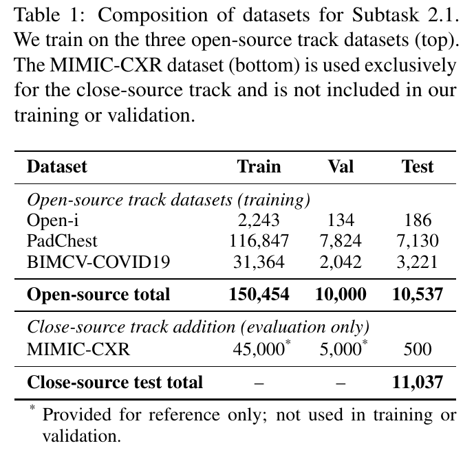
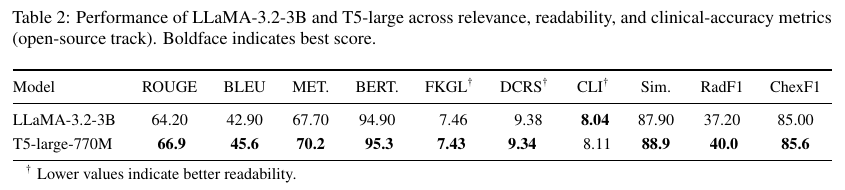
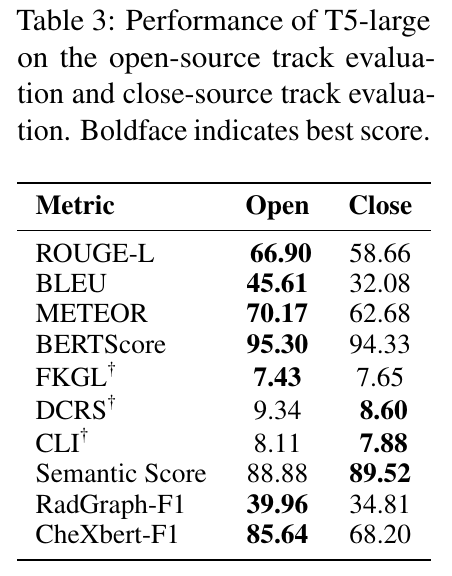
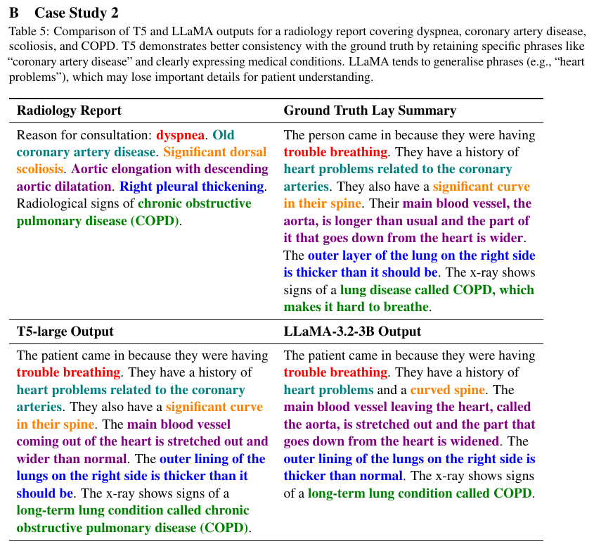

# Notes: AEHRC at BioLaySumm 2025

Zhang et al., 2025. BioNLP 2025 Shared Tasks.
https://aclanthology.org/2025.bionlp-share.21/

## Summary

The paper is a system report for Subtask 2.1 of BioLaySumm 2025. The task is to turn radiology reports into plain language. The authors fine tune two models on the same data. One is T5-large, which is the original T5 with 770M parameters and not FLAN-T5. The other is LLaMA-3.2-3B. They want to know which one is better.

They used about 150 thousand reports from three public datasets. Both models were trained for 6 epochs with a learning rate of 2e-5. The batch size was 8 and the max input length was 2048 tokens. They picked the best model using BERTScore on the validation set. T5 reads the report in the encoder and writes the summary in the decoder. LLaMA gets the report and summary joined into one text.

This is Table 1 from the paper. Most of the training data is from PadChest. MIMIC-CXR is not used for training and only appears in the closed track test set.

## Results

T5 won on 9 of 10 metrics. For example ROUGE was 66.9 for T5 and 64.2 for LLaMA. T5 is also smaller, so the authors say it is more efficient. The model ranked first in the shared task.

This is Table 2 from the paper. The only metric where LLaMA is better is CLI.

This is Table 3. It compares the same T5 model on the two tracks. The scores drop a lot on the closed track. For example CheXbert F1 goes from 85.64 to 68.20. The authors say they cannot tell how much of this comes from MIMIC-CXR.

This is Case Study 2 in the appendix. The colours in the paper match the same finding in each text. LLaMA writes heart problems and a curved spine. The reference and T5 say the heart problems are related to the coronary arteries and the spine curve is significant. So LLaMA loses some detail here. This is a good example of an omission.

Source of all images: Zhang et al., 2025, pages 173, 174 and 178.

## Thoughts

The comparison is useful, but I do not trust all of it. Each model was trained only once and the readability scores are almost the same, so the gap may be small noise. There are only two examples and no count of mistakes. The dataset paper by Zhao et al. says the reference answers were made with GPT-4o, so a high ROUGE may only mean the model copies GPT-4o.

The paper did not try LoRA or FLAN-T5, which is what my project does. It also reports on the hidden test set, so I cannot compare my numbers with its numbers directly. I will use its training settings for my full fine tuning run and its examples as a guide for my error analysis. My baselines are different, because the assignment asks for a zero-shot model, so I will compare against the untuned model and against copying the report.
