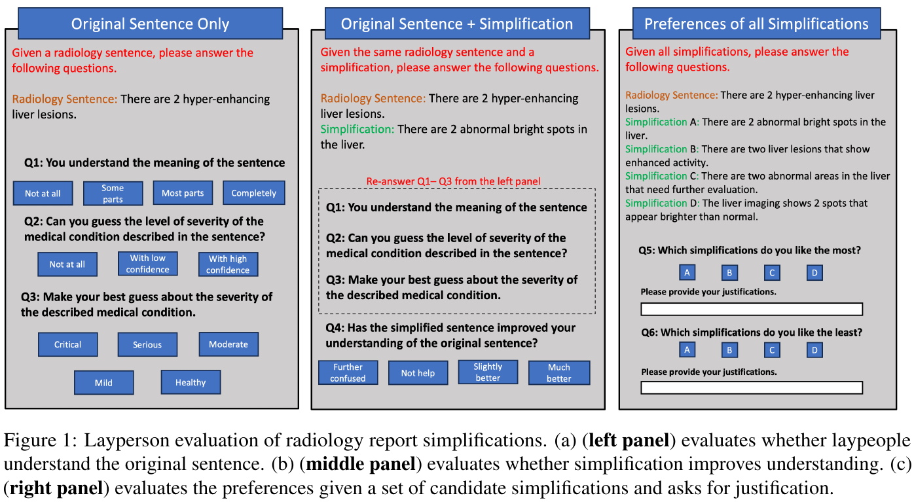
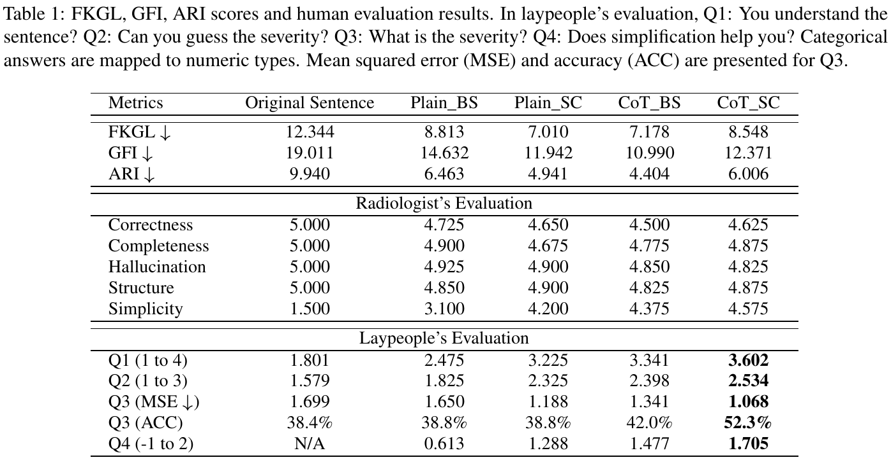
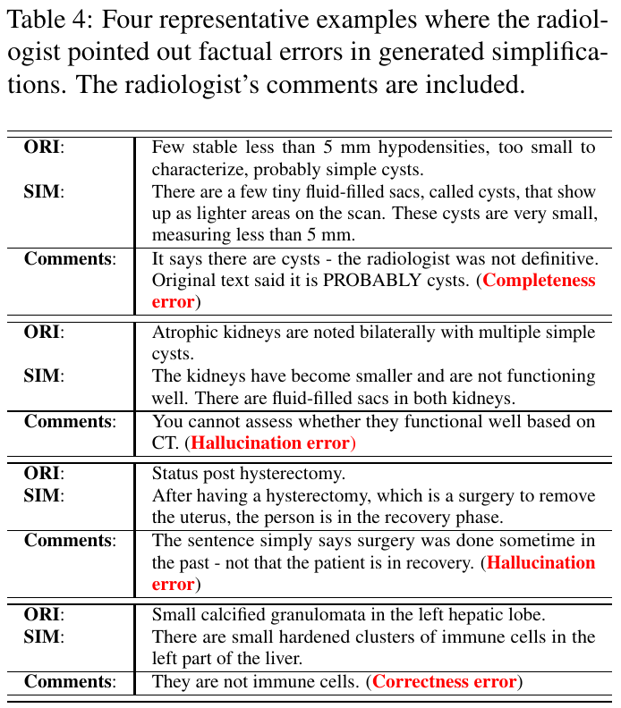
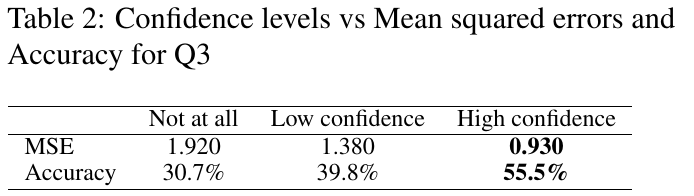

# Notes: Yang et al. 2024, Radiology Report Simplification

Yang, Cherian and Vucetic, 2024. Two-Pronged Human Evaluation of ChatGPT Self-Correction in Radiology Report Simplification. Findings of ACL 2024.
https://arxiv.org/abs/2406.18859

## Summary

The paper asks how we should judge a simplified radiology report. The authors say that ROUGE is not enough, because many different simplifications can be good. So they use people instead. One radiologist checks the facts. Eight students with no medical training check if the text is easy to understand.

The radiologist scores four things. Correctness asks if the meaning is right. Completeness asks if important information is missing. Hallucination asks if something was added that is not in the original. Structure asks if the text names the body part, the finding and what it means. The students guess how serious the condition is, and this is compared with the radiologist's answer.

This is the questionnaire that the students answered. The left panel shows only the original sentence. The middle panel adds the simplified sentence. The right panel asks which simplification they like the most and the least.

They tested 40 sentences from MIMIC-III. The simplifications came from ChatGPT-3.5 in four versions called Plain_BS, Plain_SC, CoT_BS and CoT_SC. BS is the first answer. SC is the answer after self correction. There was no fine tuning and no reference answer.

## Results

This is the main results table. CoT_SC is the version with chain of thought and self correction. It has the best scores from the students. Plain_BS is the plain prompt with no correction. It has the highest correctness from the radiologist but the lowest simplicity.

The simplified texts were much easier to read. The FKGL grade level went from 12.3 for the original to between 7.0 and 8.8. The radiologist gave very high factuality scores to all four versions. But there were still eight factual errors in the two self correction versions. Table 4 shows four of them. The first one is the most important for me. The original says the cysts are probably simple. The simplified text says there are cysts. So the doubt is lost. The radiologist called this a completeness error.

The second result is about confidence. Students who felt very sure still guessed the severity correctly only 55.5 percent of the time. So a text that feels easy is not always understood.

Source of all images: Yang et al., 2024, pages 4, 6, 7 and 8 of the arXiv version.

## Thoughts

The error types are the most useful part for me. I will use correctness, completeness and hallucination, and add one more type for a doubt that becomes a sure statement. The hallucinations came from the model explaining too much. Students liked answers that said how serious the finding is, but the report often does not say this, so such a statement could also be a hallucination. The numbers can also mislead. CoT_SC has a higher FKGL than Plain_SC and CoT_BS, but was rated the simplest, and it got the best severity guess accuracy at 52.3 percent.

The study is small, with 40 sentences and one radiologist. It also uses ChatGPT prompts and not a trained model, so I cannot compare its numbers with mine. I do not have a radiologist, so I will label the errors myself and say this is a limit of my report.
