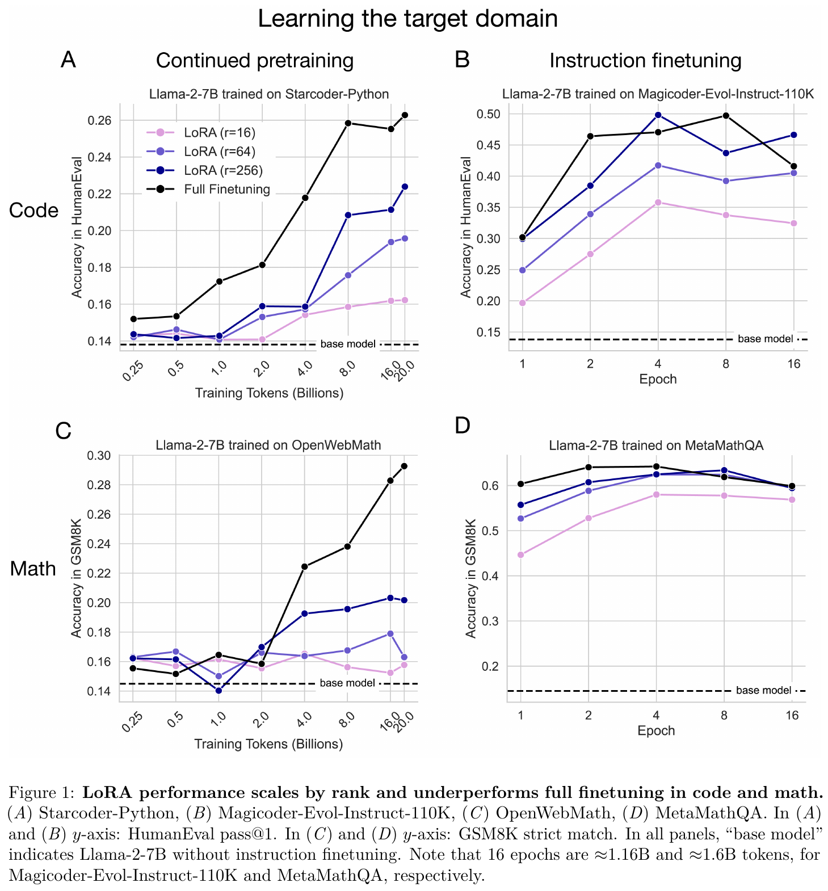
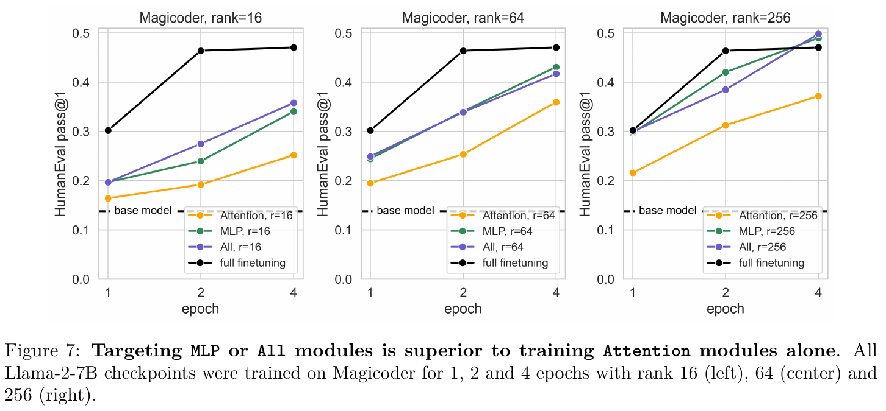
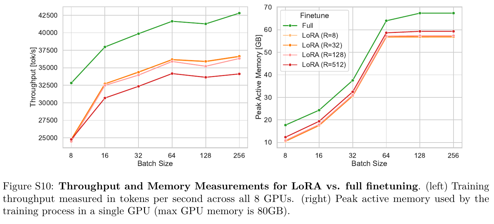

# Notes: LoRA Learns Less and Forgets Less

Biderman et al., 2024. LoRA Learns Less and Forgets Less. Transactions on Machine Learning Research.
https://arxiv.org/abs/2405.09673

## Summary

The paper asks if LoRA can match full fine tuning on hard tasks. The authors train Llama-2-7B on code and on maths. They use LoRA with rank 16, 64 and 256 on all linear layers and compare it with full fine tuning. They measure how well the model learns the new domain, and how much general knowledge it forgets.

## Results

LoRA learns less. For code, the score is HumanEval, which is the share of programming problems solved. At epoch 4, rank 16 and 64 reach only 0.358 and 0.417, while rank 256 reaches 0.498. This matches full fine tuning, which peaks at 0.497 at epoch 8. For maths, rank 64 is already close. LoRA also forgets less than full fine tuning, and a higher rank forgets more.

The paper also shows how to set up LoRA. Alpha is the scaling factor of the update, and it should be 2 times r. The learning rate should be about ten times higher than for full fine tuning. LoRA should be added to every linear layer, because adding it only to the attention layers is much worse. Most of the gain comes from the MLP layers.

LoRA is about 15 percent slower in tokens per second. It saves about 40 percent of peak memory at a small batch size, but only about 15 percent at a large batch size.

Source of the images: Biderman et al., 2024, pages 5, 11 and 39 of the arXiv version.

## Thoughts

This paper changes my plan, so I will not run only r equal to 8. I will compare a small and a large rank, use alpha equal to 2 times r, adapt all the linear layers, and keep one run on the query and value matrices to check it against the original LoRA paper. However, the paper uses a 7B decoder only model on code and maths, so its results may not hold for FLAN-T5-base on summarisation. My guess is that radiology reports are English text, so a small rank may be enough. The speed and memory results are the most useful for my report, and I will measure both myself.
