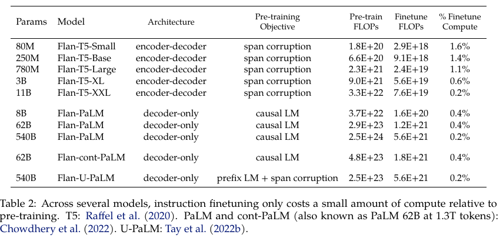
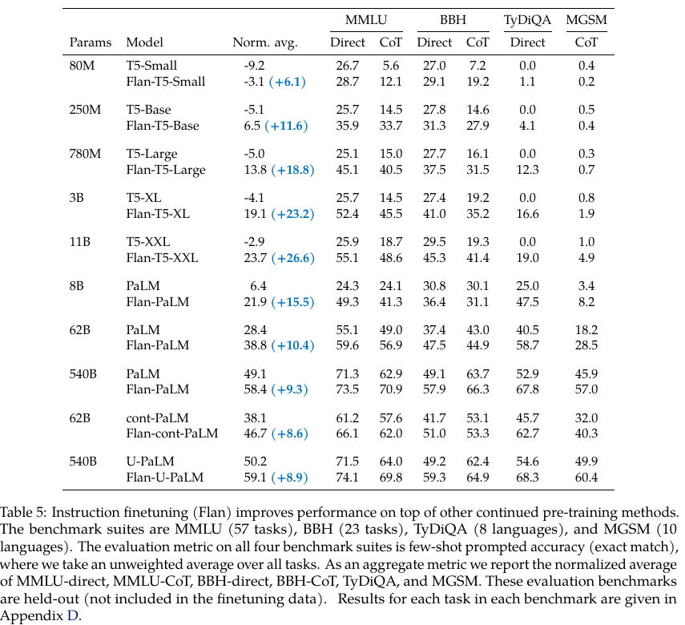

# Notes: Scaling Instruction-Finetuned Language Models

Chung et al., 2022. Scaling Instruction-Finetuned Language Models. arXiv.
https://arxiv.org/abs/2210.11416

## Summary

A pretrained language model learns from raw text. It does not always follow instructions well. Instruction finetuning is an extra training step. The model sees many tasks written as instructions, each with a good answer. The authors call this procedure Flan. They study three things. These are the number of tasks, the model size and the use of chain of thought data.

The training data has 1,836 tasks from four mixtures. They apply Flan to PaLM, U-PaLM and T5. The T5 models are called Flan-T5 and they range from 80M to 11B parameters. The checkpoints are public. My project uses Flan-T5-base, which the paper lists as 250M parameters. The checkpoint on Hugging Face has 247.6M, so I write 248M in my report. For all T5 sizes the authors use batch size 64, dropout 0.05 and learning rate 5e-4. They also use the Adafactor optimizer, a constant learning rate and packing of several examples into one sequence.

This is Table 2 from the paper. The extra training costs only 1.4 percent of the pre-training compute for the base model.

## Results

Instruction finetuning helps every model. The gain is large for the T5 family. For the base size the normalised average score goes from -5.1 to 6.5. The MMLU direct score goes from 25.7 to 35.9. The paper also says that Flan-T5-XL, with 3B parameters, beats GPT-3 175B on MMLU. The gain grows with model size, but even the small model improves.

The scores are few-shot accuracy on held-out tasks. The paper uses MMLU, BBH, TyDiQA and MGSM. The T5 baseline in this table is the LM-adapted version. It is the original T5 trained for 100B more tokens on a language modelling objective. So the table does not compare Flan-T5 with the original T5.

This is Table 5 from the paper. The rows for T5 and Flan-T5 are at the top.

Source of both images: Chung et al., 2022, pages 5 and 11 of the arXiv version.

## Thoughts

This paper is background for my model choice and not a source for my method. All the benchmarks are question answering or reasoning tasks. They say nothing about summarisation, readability or medical text. I have not checked whether the training mixture contains any radiology reports. So I cannot say that Flan-T5 is a better start than T5 for my task, and I need to test it if I want to claim this.

The training settings in the paper are for instruction tuning on a huge mixture. The learning rate of 5e-4 is much larger than the 2e-5 used by AEHRC. I will not copy it for my full fine tuning run. I checked the AEHRC paper and it used the original T5-large, not a Flan version. So my results cannot be compared directly with theirs, and the model is also three times larger than mine. The note on LoRA Learns Less and Forgets Less says that LoRA needs a learning rate about ten times higher than full fine tuning. I will keep this in mind when I choose the learning rates.
