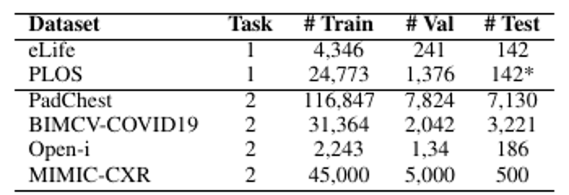
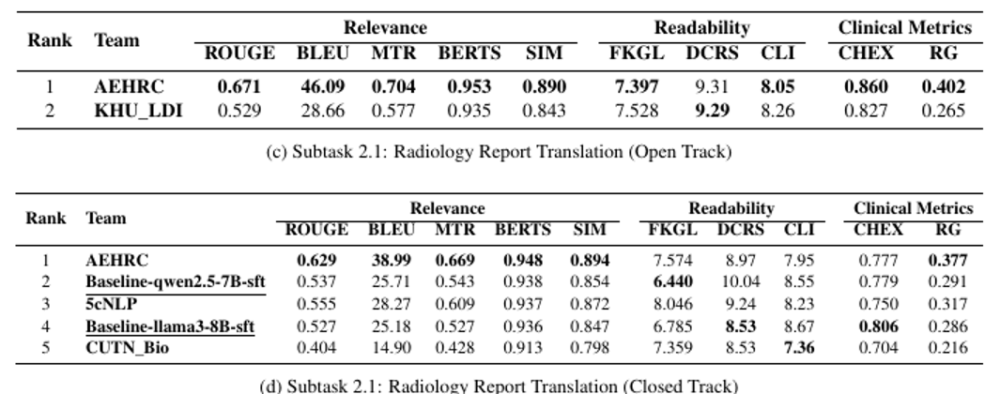

# Notes: Overview of the BioLaySumm 2025 Shared Task

Xiao et al., 2025. Overview of the BioLaySumm 2025 Shared Task on Lay Summarization of Biomedical Research Articles and Radiology Reports. BioNLP Workshop at ACL 2025.
https://aclanthology.org/2025.bionlp-1.31/

## Summary

This paper is written by the organisers. Task 2 is new this year and turns radiology reports into plain language. My project is Subtask 2.1, which is text to text. The test sets were blind and scored on CodaBench. The baselines are Qwen2.5-7B and LLaMA3-8B fine tuned on the training data.

The data come from four sources, PadChest, BIMCV-COVID19, Open-i and MIMIC-CXR. The lay versions were made with the method of Zhao et al., which used GPT-4o. The three open sources give 150,454 training reports, which matches my AEHRC note. MIMIC-CXR adds 45,000 more. The Open-i validation size is printed as 1,34, which is a typo. The AEHRC paper and the Hugging Face dataset both give 134, so the open track has 150,454 training, 10,000 validation and 10,537 test reports.

The metrics are in three groups. Relevance uses ROUGE, BLEU, METEOR, BERTScore and a similarity score. Readability uses FKGL, DCRS and CLI, and lower is better. The clinical group uses CheXbert and RadGraph. The final rank is the average of the three groups after min-max normalisation.

## Results

AEHRC ranked first in both tracks. In the closed track its ROUGE was 0.629 and the two baselines scored 0.537 and 0.527. But it did not win every metric. The Qwen baseline has a better FKGL and the LLaMA baseline has a better CheXbert score.

Source of both images: Xiao et al., 2025, pages 367 and 369.

## Thoughts

The rankings are weaker than they look. The open track has only two teams, and the closed track has two baselines among its five rows. All metrics are automatic, and the references were written by an LLM, so a high score mostly means close agreement with that LLM.

The assignment asks for ROUGE-1, ROUGE-2, ROUGE-L and ROUGE-Lsum, so I will report all four. I will also use FKGL for my grade 6 target, add BERTScore, DCRS and CLI, and add CheXbert and RadGraph if there is time. I checked the test split on Hugging Face and its lay summaries are empty, so I cannot score the test set. I will report on the validation set, which is also what the assignment asks for.

I rechecked the AEHRC data section. The 45,000 MIMIC-CXR training reports in this table belong to the closed track, and the AEHRC caption says they did not train on them. So my two notes agree. MIMIC-CXR also needs separate PhysioNet access, and the assignment only asks for the LaymanRRG data, so I will use the open track only.
