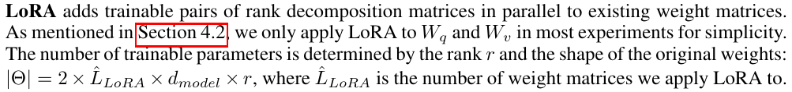
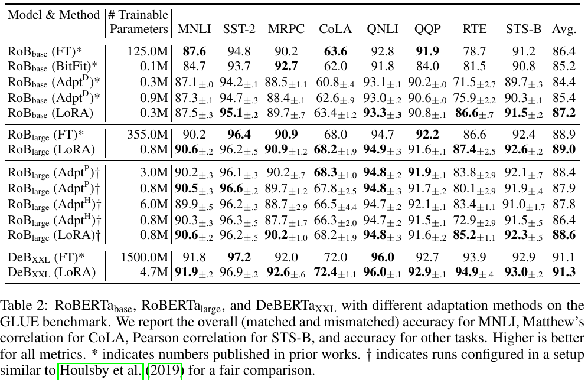
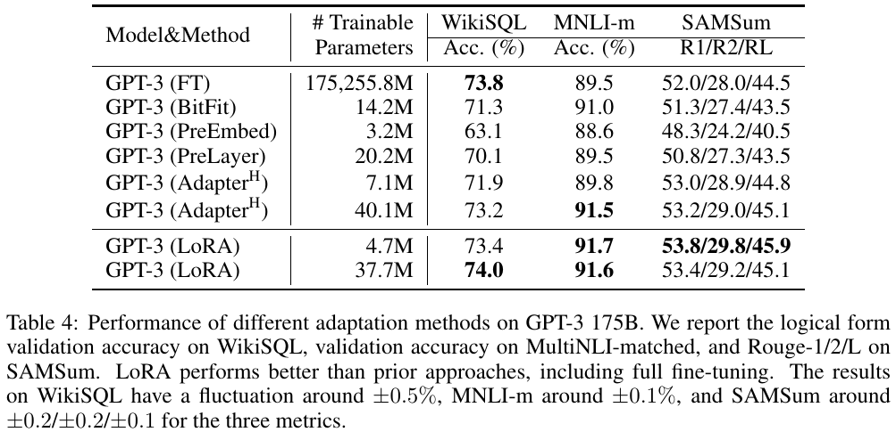
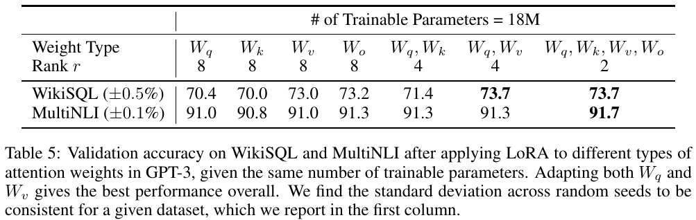
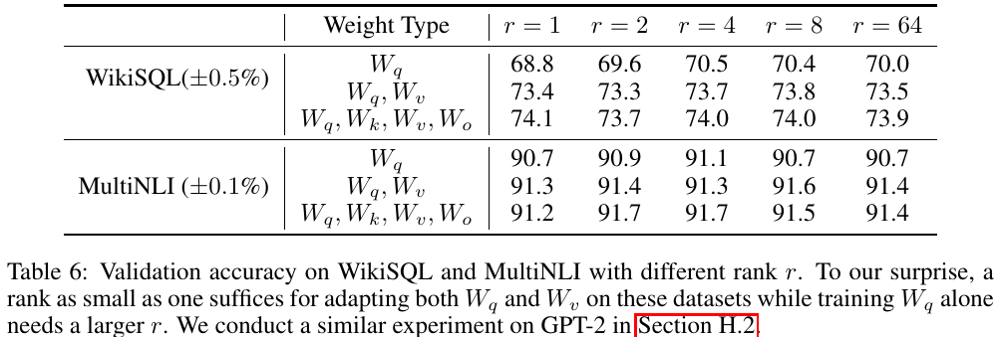
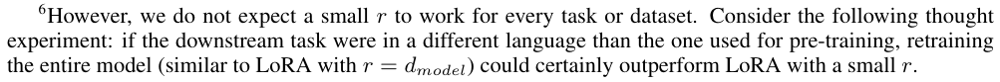

# Notes: LoRA

Hu et al., 2022. LoRA: Low-Rank Adaptation of Large Language Models. ICLR.
https://arxiv.org/abs/2106.09685

## Summary

Full fine tuning updates every weight in the model. This needs a lot of memory, and every task needs its own full copy of the model. LoRA fixes this by freezing the original weights W0. It adds two small matrices B and A next to a weight matrix. The update to the weight is then B times A. Only A and B are trained.

The rank r is the small inner size of these two matrices. It is much smaller than the size of W0. At the start A is random and B is all zeros. So the model begins exactly like the original model. The output of BA is also scaled by alpha divided by r. The authors do not tune alpha. They set it to the first r they try. After training, BA can be added into W0. So the model is not slower at inference.

The authors apply LoRA only to the query and value matrices of the attention layers in most experiments. The number of trainable parameters is then two times the number of adapted matrices, times d_model, times r. The two is there because each matrix gets one A and one B.

Source of both images: Hu et al., 2022, pages 1 and 6 of the arXiv version.

## Results

The paper says LoRA is as good as full fine tuning or better, with far fewer trainable parameters. In Table 2, RoBERTa base with full fine tuning has 125.0M trainable parameters and an average score of 86.4. LoRA has only 0.3M and scores 87.2.

Table 4 is on GPT-3 175B and includes a dialogue summarisation task called SAMSum. LoRA with 4.7M parameters gets a ROUGE-L of 45.9. Full fine tuning gets 44.5. But full fine tuning is slightly better on WikiSQL, with 73.8 against 73.4. So LoRA does not win everything.

The paper also tests which weights to adapt. Table 5 shows that with the same number of parameters, adapting both the query and the value matrices works better than adapting only one of them. Table 6 shows that a very small rank is enough. On GPT-3 the scores hardly change from r equal to 1 up to r equal to 64 when both the query and value matrices are adapted.

Source of the three tables: Hu et al., 2022, pages 8 and 10 of the arXiv version.

## Thoughts

The paper never tests T5 or FLAN-T5, and its savings in memory and speed are measured on GPT-3 175B. So I must measure my own parameter count, VRAM and tokens per second. Many full fine tuning scores in its tables are copied from older papers, so the claim that LoRA is as good or better is not a perfect comparison. Footnote 6 also says a small r may fail when the new task is very different from the pre-training data. Radiology reports are full of medical words, so this is worth testing.

I will start with r equal to 8 on the query and value matrices, then try a larger r and compare with full fine tuning. My rough estimate for FLAN-T5-base is about 0.9M trainable parameters, and I will check it in code. Another paper says LoRA can learn less than full fine tuning on hard tasks. I have not read it yet and want to before the discussion.
